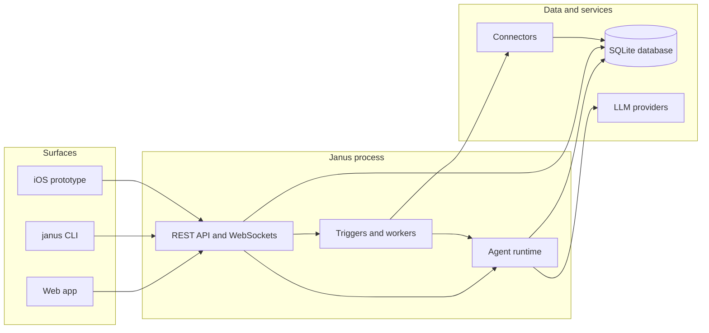

# Architecture

Janus is one program you run on your own machine or server. It holds your mail, calendar, notes and chats in a local database, and runs one personal agent for each user. You talk to it through the web app, the `janus` command line, or the iOS prototype. Everything else, from the morning briefing to processing new mail, happens in the background as **triggers**.

## Surfaces

The **web app** is the main way to use Janus: dashboard, chat, Emails, Planner, Memory & Knowledge, Agent Tasks and Settings, in one of three looks (Classic, Terminal, Rusty Console). The **CLI** starts and manages the server (`janus start`, `janus update`, `janus service install`) and has quick commands such as `janus brief`. The **iOS prototype** can log in, show the dashboard and chat. All three talk to the same API. See [Frontend](tech-spec/frontend.md) and [Mobile iOS](tech-spec/mobile-ios.md).

## REST API and WebSockets

One FastAPI server answers every request. Each request is checked for a valid login, and every query is limited to the data of the user who asked, so users on a shared install never see each other's mail, chats or notes. Three WebSockets stream live data: `/ws/chat` for chat, `/ws/briefing` for the morning briefing, and `/ws/changes`, which tells your open tabs to refresh when something changed in the background. See [Backend and API](tech-spec/backend-api.md) and [Authentication and Security](tech-spec/auth-security.md).

## Agent runtime

Every piece of agent work, a chat message or a background run, goes through one runtime. It builds Janus's instructions from your [character profile](knowledge.md#character-profile), a short [memory index](knowledge.md#the-memory-index) and a one-line index of the skill library, picks the toolboxes the task needs, and checks each one against your [tool permissions](tools.md#how-permissions-work) before the model may use it. In chat, risky tools such as sending mail ask you first with an approval card. Text from outside (mail, web pages, messages) is marked as untrusted, and a suspected prompt injection blocks consequential tools for the rest of the turn. See [Background Workers and Runtime](tech-spec/background-workers-runtime.md) and [LLM and Agent Safety](tech-spec/llm-agent-safety.md).

## Triggers and workers

Background threads in the same process keep Janus up to date: one per mail account (IMAP IDLE or Outlook polling), one per WhatsApp account and Telegram bot, a planner sync every 30 minutes, a knowledge indexer, a status probe and the auto-updater. The trigger worker runs **triggers**: scheduled ones such as the Morning briefing, event-driven ones such as Mail processing, and the ones Janus schedules or that you define yourself. Unattended runs use only the tools you allowed for them. See [Triggers](runtime-triggers.md) for how to use them and the [Architecture Overview](tech-spec/architecture-overview.md) for the process model.

## Database

All state lives in one database: SQLite by default, PostgreSQL if you configure it. Passwords and API keys are encrypted with a key file next to the database; back up both together. Janus migrates the database itself when it starts or updates. See [Data Model and Migrations](tech-spec/data-model-migrations.md).

## LLM providers

Janus works with a local model through Ollama, or with OpenAI, OpenRouter, Gemini, Anthropic, GitHub Models or Azure OpenAI. You can use a different model for chat, for small background tasks, and for each trigger. Anything but a local model sends the text it works on to that provider. See [Configuration](configuration.md) and [LLM and Agent Safety](tech-spec/llm-agent-safety.md#llm-providers).

## Connectors

Connectors bring outside data in and, where you allow it, act on it: IMAP and Outlook mail, Google and Microsoft calendars, Google Tasks, Jira, WhatsApp, Telegram, GitHub, Linear, web search, remote MCP servers, remote agents and signed webhooks. Imported calendars and tasks are read-only; Janus keeps its own writable task list. See [Integrations](integrations.md).

## Deployment

Janus runs as a single process per database: from a git checkout, as an installed Python tool, or as a systemd user service. It can update itself from GitHub releases. See [Operations](operations.md) and [Deployment and Operations](tech-spec/deployment-operations.md). The full technical index is the [Technical Specification](tech-spec.md).
